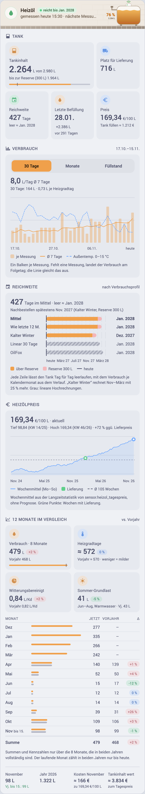
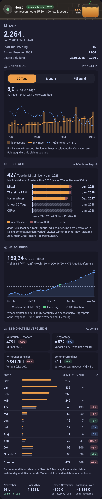
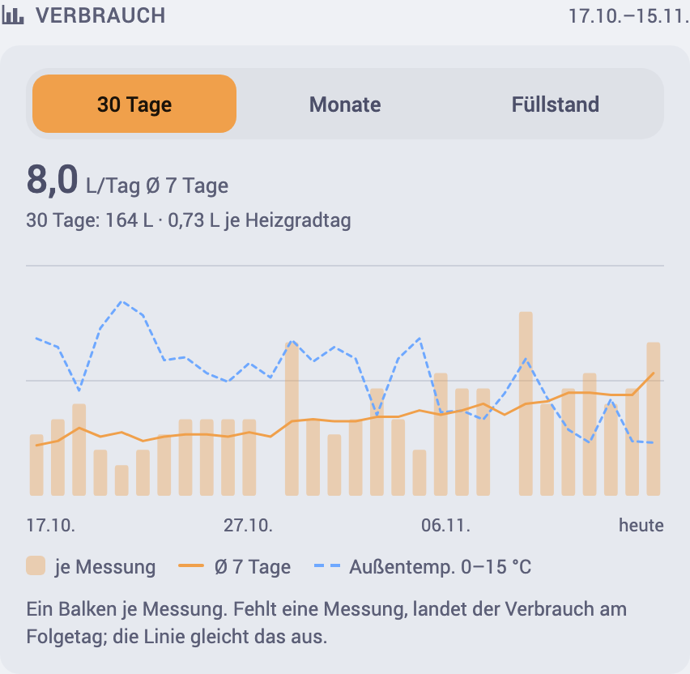
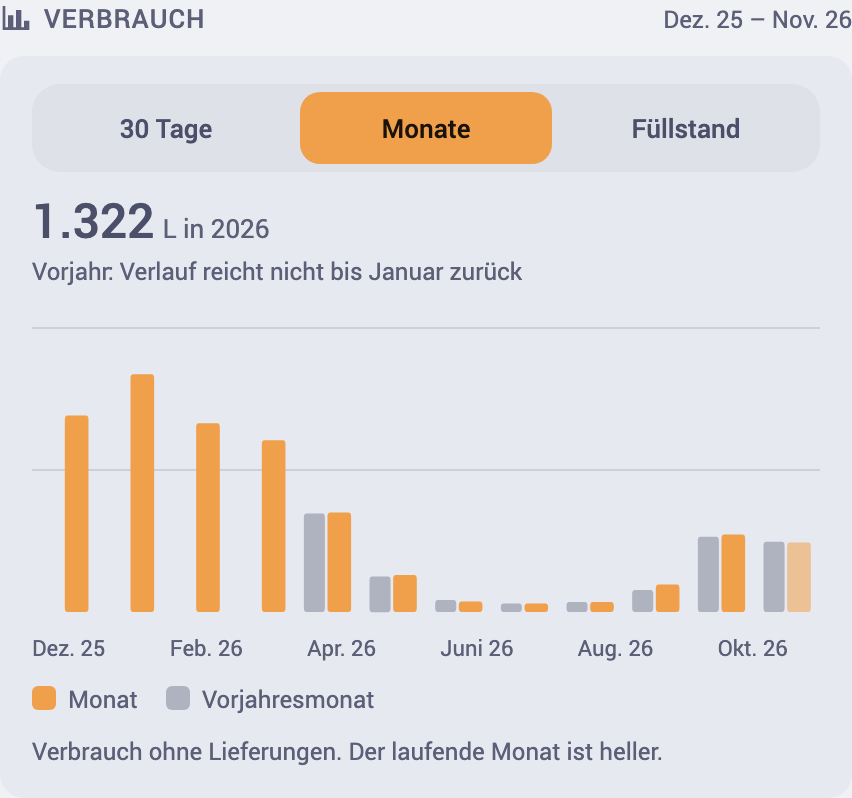
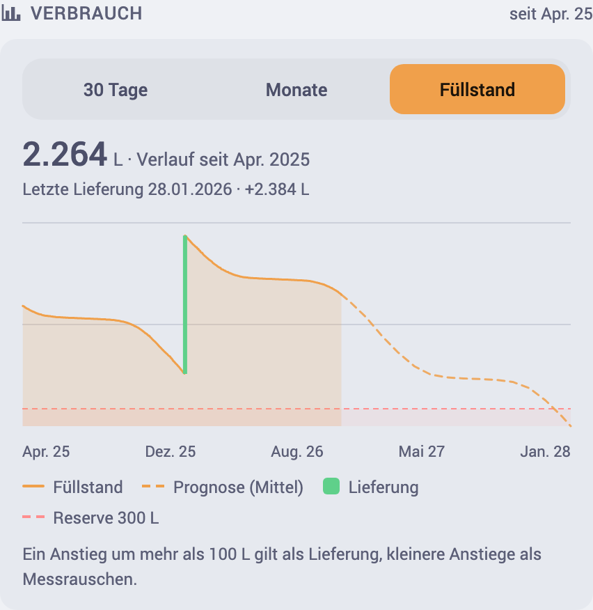
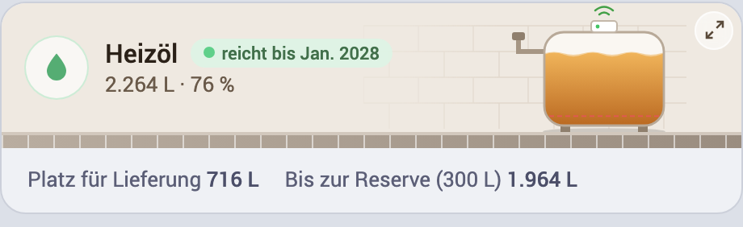

# Oil Overview Card

[](https://my.home-assistant.io/redirect/marketplace_repository/?owner=hoentaex&repository=ha-oil-overview-card&category=plugin)
[](https://github.com/hoentaex/ha-oil-overview-card/releases/latest)
[](https://github.com/hoentaex/ha-oil-overview-card/actions/workflows/validate.yml)
[](https://github.com/hoentaex/ha-oil-overview-card/actions/workflows/hacs.yml)
[](LICENSE)

**[Deutsch](#deutsch) · [English](#english)**

| Hell / Light | Dunkel / Dark |
|---|---|
|  |  |

---

## Deutsch

Lovelace-Karte für eine **Ölheizung**: Tank, Verbrauch, Reichweite und Heizölpreis in **einer** Karte. Gebaut für
einen [OilFox](https://www.home-assistant.io/integrations/oilfox/)-Füllstandsensor, funktioniert aber mit jedem
Sensor, der den Füllstand in Litern meldet.

Aufbau und Look orientieren sich an den Karten von [juju35](https://github.com/juju35). Schwesterprojekte:
[Energy Overview Card](https://github.com/hoentaex/ha-energy-overview-card),
[Tibber Battery Card](https://github.com/hoentaex/ha-tibber-battery-card).

> [!WARNING]
> **Privates Hobbyprojekt.** Die Karte ist für meine eigene Installation entstanden und wird in der Freizeit gepflegt.
> Es gibt keine Gewährleistung und keinen Support: **Die Nutzung erfolgt auf eigene Gefahr.**
> Die Karte liest nur Zustände und Statistiken aus Home Assistant – sie schaltet nichts.

### Was die Karte zeigt

- **Tank:** Füllstand mit trägem Öl und ein paar aufsteigenden Bläschen im Kopf; darunter Kennzahl-Kacheln:
  Tankinhalt mit Reservemarke, Platz für die nächste Lieferung, Reichweite, letzte Befüllung und Preis. Fehlt ein
  Wert (kein Preis-Sensor, keine Lieferung), entfällt seine Kachel und die übrigen rücken ohne Lücke nach. Ein Klick
  öffnet den Dialog des Sensors.
- **Verbrauch** in drei Ansichten, mit dem Finger oder der Maus abfahrbar (die Werte-Zeile darüber springt nicht):
  - **30 Tage:** ein Balken je Messung, der 7-Tage-Schnitt und die Außentemperatur; dazu Liter je Heizgradtag.
  - **Monate:** die letzten 12 Monate neben dem Vorjahresmonat.
  - **Füllstand:** der ganze Verlauf mit Lieferungen, Reserve und der Prognose bis „leer“.
- **Reichweite:** Der Tank wird Tag für Tag mit dem Verbrauch je Kalendermonat leergerechnet – im Winter schnell, im
  Sommer kaum. Mehrere Szenarien (Mittel, wie die letzten 12 Monate, wie das Jahr davor, kalter Winter) und zum
  Vergleich die linearen Hochrechnungen. Daraus: „reicht bis …“ im Kopf und „Nachbestellen spätestens …“.
- **Heizölpreis:** Wochenmittel als Linie (keine Prognose), Tief und Hoch mit Kalenderwoche, Abstand zum bezahlten
  Preis, Wochen mit Lieferung markiert.
- **12 Monate im Vergleich:** Verbrauch, Heizgradtage, witterungsbereinigter Verbrauch (L je Heizgradtag) und
  Sommer-Grundlast gegen das Vorjahr als Kacheln mit Δ-Badge, darunter je Monat mit Δ-Badge. Gezählt werden nur Monate, die in beiden Jahren
  vollständig sind; der laufende Monat in beiden Jahren nur bis heute.
- **Fußzeile:** dieser Monat und dieses Jahr gegen das Vorjahr, Kosten des Monats, Wert des Tankinhalts.

| 30 Tage | Monate | Füllstand |
|---|---|---|
|  |  |  |

### Woher die Zahlen kommen

Alles stammt aus der **Langzeitstatistik** von Home Assistant (`recorder/statistics_during_period`), es gibt keine
eigene Datenhaltung:

- **Verbrauch** aus den täglichen Min-/Max-Werten des Füllstands. Der Füllstand kann nur sinken – außer bei einer
  Lieferung. Steigt er an einem Tag um mehr als `refill_threshold` (Standard 100 L), war das eine **Lieferung**;
  kleinere Anstiege sind Messrauschen und werden ignoriert. Fällt eine Messung aus, landet ihr Verbrauch am Folgetag.
- **Heizgradtage** aus dem Tagesmittel der Außentemperatur: `max(0, Heizgrenze − Tagesmittel)`, Heizgrenze
  `heating_base_temp` (Standard 15 °C).
- **Preis** aus den Wochenmitteln (Montag bis Sonntag) des Preis-Sensors.
- Tages- und Monatsgrenzen folgen der **Zeitzone des Home-Assistant-Servers**.

Die Statistik wird geladen, wenn die Karte erscheint und wenn der Füllstand einen neuen Messwert bekommt (beim
OilFox einmal am Tag), sonst höchstens alle 30 Minuten. Große Karte und Mini-Karte teilen sich die Abfrage.

### Was du brauchst

| Baustein | Wofür | Pflicht? |
|---|---|---|
| Home Assistant 2024.8 oder neuer | | ja |
| Füllstand in Litern mit Langzeitstatistik (`state_class: measurement`), z. B. OilFox `fillLevelQuantity` | alles | ja |
| Tankinhalt (`capacity`) | Prozent, Platz für Lieferung | empfohlen (sonst aus Litern und Prozent berechnet) |
| Außentemperatur mit Statistik | Heizgradtage, witterungsbereinigter Vergleich | empfohlen |
| Preis-Sensor mit Statistik (€ je 100 L) | Preisverlauf, Kosten | optional |
| Helfer für die letzte Lieferung (Datum, Menge, Preis) | Tank-Angaben, Lieferpreis | optional |

Fehlt eine Entity oder ist sie `unavailable`, blendet die Karte den Wert oder Abschnitt aus bzw. zeigt „–“. Für den
12-Monats-Vergleich braucht es mehr als ein Jahr Verlauf; bis dahin steht dort ein Hinweis.

### Installation

**Über den Marketplace:**

[](https://my.home-assistant.io/redirect/marketplace_repository/?owner=hoentaex&repository=ha-oil-overview-card&category=plugin)

oder von Hand: **Marketplace → ⋮ → Benutzerdefinierte Repositories** → `https://github.com/hoentaex/ha-oil-overview-card`,
Typ **Dashboard** → *Oil Overview Card* installieren → Browser neu laden.

**Manuell:** `ha-oil-overview-card.js` aus dem [letzten Release](https://github.com/hoentaex/ha-oil-overview-card/releases/latest)
nach `config/www/` kopieren und als Ressource `/local/ha-oil-overview-card.js` (Typ *JavaScript-Modul*) eintragen.

### Konfiguration

Minimal:

```yaml
type: custom:oil-overview-card
level_entity: sensor.oilfox_xxx_filllevelquantity
```

Beispiel:

```yaml
type: custom:oil-overview-card
level_entity: sensor.oilfox_of0000000000_filllevelquantity
percent_entity: sensor.oilfox_of0000000000_filllevelpercent
last_measurement_entity: sensor.oilfox_of0000000000_lastmeasurement
next_measurement_entity: sensor.oilfox_of0000000000_nextmeasurement
days_reach_entity: sensor.oilfox_of0000000000_daysreach
refill_date_entity: input_datetime.heizol_letzte_befullung
refill_amount_entity: input_number.heizol_letzte_liefermenge
outdoor_temp_entity: sensor.wolf_aussentemperatur
price_entity: sensor.heizol_tagespreis
paid_price_entity: input_number.heizol_preis
capacity: 2980
reserve: 300
```

| Option | Standard | Bedeutung |
|---|---|---|
| `level_entity` | – | **Pflicht.** Füllstand in Litern |
| `percent_entity` | – | Füllstand in %; sonst aus `capacity` berechnet |
| `capacity` | aus Litern und % | Tankinhalt in Litern |
| `reserve` | `300` | Nachbestell-Reserve in Litern (rote Linie, „Nachbestellen spätestens“) |
| `last_measurement_entity` / `next_measurement_entity` | – | Zeitpunkte für die Unterzeile |
| `days_reach_entity` | – | Reichweite des Sensors in Tagen (OilFox `daysReach`): als Vergleichszeile und solange der Verlauf lädt |
| `refill_date_entity` / `refill_amount_entity` | – | Letzte Lieferung (`input_datetime` / `input_number`) |
| `refill_threshold` | `100` | Anstieg in Litern, ab dem ein Tag als Lieferung zählt |
| `outdoor_temp_entity` | – | Außentemperatur (Heizgradtage) |
| `heating_base_temp` | `15` | Heizgrenze in °C |
| `price_entity` | – | Aktueller Heizölpreis (Verlauf aus seiner Statistik) |
| `paid_price_entity` | – | Preis der letzten Lieferung |
| `price_per_litres` | `100` | Preise gelten je 100 L (`1`: je Liter) |
| `sections` | alle | Auswahl und Reihenfolge aus `header`, `tank`, `consumption`, `range`, `price`, `compare`, `footer` |
| `default_view` | `days` | Verbrauchsansicht beim Öffnen: `days`, `months`, `level` |
| `animations` | `true` | Öl-Animation; bei „Bewegung reduzieren“ ist sie immer aus |
| `illustration` | `true` | Illustrierter Kopf: der Tank im Keller (Füllstand, Reservelinie, OilFox), Titel und Pill auf der Kellerwand. `false` = schlichter Kopf mit dem Tankbild im Abschnitt Tank |
| `illustration_theme` | wie das Theme | `day` oder `night`; ohne Angabe kommt das Nachtbild mit dem dunklen Theme |
| `name` / `subtitle` | – | Eigener Titel / eigene Unterzeile |
| `language` | HA-Sprache | `de` oder `en` |

Farben lassen sich über das Theme oder `card_mod` setzen: `--ooc-oil-color`, `--ooc-good-color`, `--ooc-warn-color`,
`--ooc-bad-color`, `--ooc-temp-color`.

### Mini-Karte

`custom:oil-overview-mini-card` zeigt denselben illustrierten Kopf mit Tank, Litern, Prozent und „reicht bis …“, darunter Platz für die Lieferung und Liter bis zur Reserve (mit `illustration: false` alles in einer Zeile). Der Knopf rechts öffnet
die große Karte als Popup; mit `popup: false` klappt sie stattdessen darunter auf. Sie nimmt dieselben Optionen.



### Visueller Editor

Beide Karten haben einen Editor mit Gruppen für Tank, Lieferungen, Verlauf und Wetter, Preis und Darstellung. Neue
Karten werden mit einem OilFox-Gerät, der Außentemperatur und passend benannten Helfern vorbelegt.

### Helfer, die sich lohnen (optional)

Die Karte braucht keine eigenen Helfer. Für andere Dashboards und Automationen hat sich in meiner Installation
bewährt (alles als UI-Helfer):

- `input_number.heizol_geliefert_gesamt` (Summe aller Lieferungen) und ein **Template-Sensor** „Heizöl Verbrauch
  gesamt“ mit `state_class: total_increasing`:
  `{{ [this.state | float(0), geliefert − füllstand] | max }}` – er kann nur steigen und taugt als Quelle für
  Utility-Meter (täglich / monatlich / jährlich). Utility-Meter direkt auf den **Füllstand** zählen negative Werte und
  Lieferungen als Verbrauch.
- Eine **Automation**, die bei einem Anstieg um mehr als 100 L die Menge zu `heizol_geliefert_gesamt` addiert und
  Datum, Menge und Preis der Lieferung in `input_datetime` / `input_number` speichert.
- Ein **Preis-Sensor** mit `state_class: measurement` (z. B. per Scrape-Integration). Achtung bei Preisportalen:
  viele sperren bei zu häufigen Abfragen – Abfragen selten halten (z. B. zweimal am Tag per Automation und
  `homeassistant.update_entity`) und ihre Nutzungsbedingungen beachten.

---

## English

Lovelace card for **oil heating**: tank, consumption, range and heating oil price in **one** card. Built for an
[OilFox](https://www.home-assistant.io/integrations/oilfox/) level sensor, works with any sensor reporting the fill
level in litres.

> [!WARNING]
> **Private hobby project**, maintained in spare time, without warranty or support: **use at your own risk.**
> The card only reads states and statistics – it never switches anything.

- **Tank** with slowly moving oil and rising bubbles in the header; below it KPI tiles: level with the reserve mark,
  room for a delivery, range, last delivery and price. A missing value drops its tile and the rest close up; a click
  opens the sensor's dialog.
- **Consumption** (scrubbable, the readout keeps two lines): 30 days with a 7-day mean and the outdoor temperature,
  12 months next to the previous year, and the level over time with deliveries and the forecast.
- **Range:** the tank is run down day by day with the consumption per calendar month (several scenarios, plus the
  linear projections), giving “lasts until …” and “order by …”.
- **Price:** weekly means (no forecast), low/high by calendar week, change against the price paid.
- **12 months compared:** consumption, heating degree days, weather-adjusted litres per degree day and summer base
  load against the previous year as tiles with Δ badges, only over months complete in both years.
- **Footer:** this month and year against last year, costs of the month, value of the oil in the tank.

**Data:** everything comes from Home Assistant's long-term statistics. Consumption is derived from the level's daily
min/max: the level only falls, a rise of more than `refill_threshold` (100 L) in a day is a delivery, smaller rises
are noise. Days and months follow the Home Assistant server's time zone.

**Requirements:** Home Assistant 2024.8+, a fill level in litres with long-term statistics. Recommended: tank capacity,
outdoor temperature. Optional: a price sensor with statistics (per 100 L), helpers for the last delivery.

**Install** via the Marketplace:

[](https://my.home-assistant.io/redirect/marketplace_repository/?owner=hoentaex&repository=ha-oil-overview-card&category=plugin)

or by hand: **Marketplace → ⋮ → Custom repositories** → `https://github.com/hoentaex/ha-oil-overview-card` (type
*Dashboard*). Without the Marketplace, copy `ha-oil-overview-card.js` from the latest release to `config/www/` and add it
as a JavaScript module resource.

```yaml
type: custom:oil-overview-card
level_entity: sensor.oilfox_xxx_filllevelquantity
capacity: 3000
reserve: 300
outdoor_temp_entity: sensor.outdoor_temperature
```

The options are listed in the German table above. `custom:oil-overview-mini-card` shows the tank in one row and opens
the full card as a popup (`popup: false` expands it below). Both cards have a visual editor.

## Development

```bash
npm install
npm run check        # lint (Biome), build, syntax check
npm test             # node --test, in a different time zone than the "server"
npm run demo         # http://127.0.0.1:8770/demo/ with a simulated history
npm run screenshots  # README screenshots (Playwright)
```

Tagging `vX.Y.Z` (matching `package.json`) builds the card and attaches it to a GitHub release with the changelog
section as notes.

## License

MIT, see [LICENSE](LICENSE).
